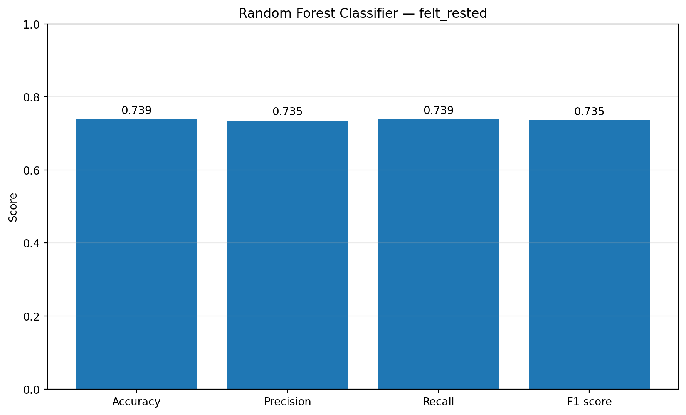

# NurseSleep AI

**Reproducible Data Science Project for Sleep Health, Shift-Work Patterns, Restfulness, and Cognitive Performance**

## Project Overview

NurseSleep AI is an exploratory data science and machine learning project that investigates sleep-related patterns, occupational differences, shift-work factors, restfulness, and cognitive-performance indicators.

The project combines data validation, exploratory data analysis (EDA), occupational subgroup analysis, and baseline machine learning to examine relationships between sleep-related variables and performance indicators.

The workflow is designed to support reproducible analysis, transparent model evaluation, and clear presentation of results.

> **Important data limitation:** Findings are limited to the data analysed in this project. They should not be interpreted as evidence about real nurses, patients, or clinical outcomes.

## Research Objectives

1. Explore sleep duration, sleep quality, and stress patterns across occupational groups.
2. Examine patterns in records labelled `Nurse`.
3. Compare shift-work and non-shift-work records using selected sleep and performance indicators.
4. Develop a baseline classification model to predict `felt_rested`.
5. Explore predictive modelling for `cognitive_performance_score`.
6. Evaluate and communicate model performance using appropriate metrics and visualisations.

These objectives are exploratory. Observed associations do not establish causation.

## Project Workflow

| Notebook | Description |
|---|---|
| `01_data_audit_and_eda.ipynb` | Data validation, quality checks, descriptive statistics, and exploratory analysis |
| `02-group shift and analysis` | Occupational group and shift-work analysis |
| `3-baseline models` | Baseline machine learning model development and evaluation |

## Technologies Used

- Python
- Jupyter Notebook
- Google Colab
- Pandas
- NumPy
- Matplotlib
- Seaborn
- Scikit-learn

## Machine Learning Results

### Random Forest Classifier

**Prediction target:** `felt_rested`

The following evaluation metrics are recorded for the baseline Random Forest classification model.

| Evaluation Metric | Score |
|---|---:|
| Accuracy | 0.738850 |
| Precision | 0.735263 |
| Recall | 0.738850 |
| F1 Score | 0.735472 |

*These scores should be verified against the final notebook evaluation output before being treated as final results.*

### Model Performance Visualization



## Results and Outputs

The repository includes a dedicated results directory.

| Folder | Contents |
|---|---|
| `results/figures/` | Model performance visualisation |
| `results/metrics/` | Random Forest evaluation metrics |
| `results/tables/` | Model performance summary table |

### Available Result Files

- `felt_rested_metrics_bar.png`
- `felt_rested_random_forest (1).csv`
- `model_performance_summary (1).csv`

## Methodology

The project follows a structured analytical workflow:

**1. Data Validation**
- Dataset dimensions and structure
- Data types and missing values
- Duplicate record checks
- Category and variable inspection

**2. Exploratory Data Analysis**
- Descriptive statistics
- Sleep-related variable distributions
- Occupational group comparisons
- Shift-work pattern exploration

**3. Machine Learning**
- Baseline Random Forest classification
- Prediction of the `felt_rested` target
- Evaluation using classification metrics

**4. Results Presentation**
- Performance metrics in CSV format
- Visual performance summary
- Organised results directory

## Reproducibility

The Jupyter notebooks provide the main analysis workflow.

To reproduce the project:

1. Open the notebooks using Google Colab or a local Jupyter environment.
2. Provide an authorised input dataset in the format expected by the notebooks.
3. Run the notebooks in numerical order.
4. Review the generated analysis, tables, figures, and model evaluation outputs.

Raw dataset files are intentionally not included in this repository.

## Responsible Use and Limitations

NurseSleep AI is an educational and exploratory data science project.

It is not intended to be used as:

- A clinical diagnostic tool
- A medical decision-support system
- A fitness-for-duty assessment
- An employment-screening tool

Model performance alone does not establish clinical validity, generalisability, or real-world reliability. Further validation using appropriate real-world data and research methods would be necessary before drawing practical conclusions.

## Repository Structure

```text
nursesleep-ai/
│
├── 01_data_audit_and_eda.ipynb
├── 02-group shift and analysis
├── 3-baseline models
│
├── results/
│   ├── figures/
│   │   ├── README.md
│   │   └── felt_rested_metrics_bar.png
│   │
│   ├── metrics/
│   │   ├── README.md
│   │   └── felt_rested_random_forest (1).csv
│   │
│   └── tables/
│       ├── README.md
│       └── model_performance_summary (1).csv
│
├── .gitignore
├── LICENSE
└── README.md
```

## Project Status

**Status: Exploratory analysis and baseline model evaluation**

The repository contains analysis notebooks, model evaluation outputs, and a performance visualisation. Further notebook execution and validation can extend the analysis and strengthen reproducibility.

## License

This project is distributed under the MIT License. See the [LICENSE](LICENSE) file for details.

---

**NurseSleep AI | Data Science • Exploratory Analysis • Machine Learning**
